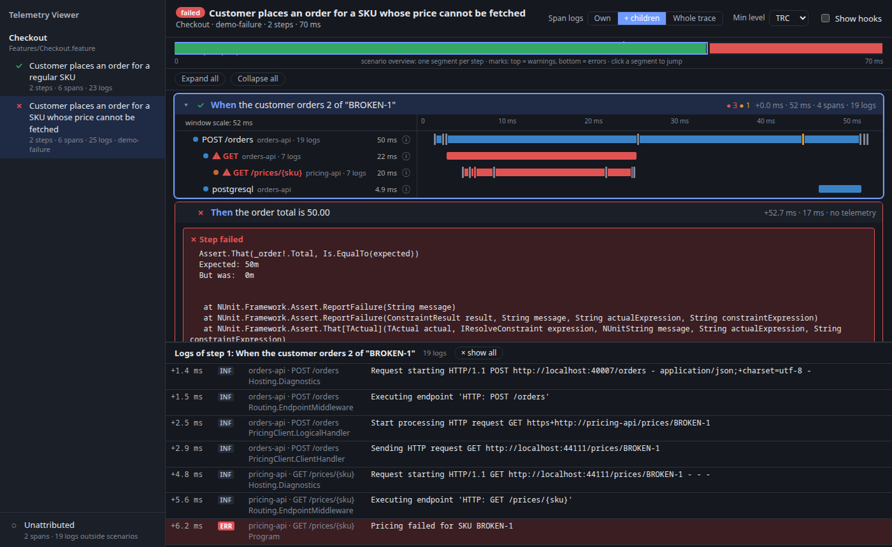

# Storks.OpenTelemetry.Reqnroll

[](https://github.com/siavol/storks-opentelemetry-reqnroll/actions/workflows/ci.yml?query=branch%3Amain)
[](https://sonarcloud.io/summary/new_code?id=siavol_storks-opentelemetry-reqnroll)

A Reqnroll formatter that receives your application's OpenTelemetry traces and logs during `dotnet test` and shows them by scenario and step in a Telemetry Viewer.



## Why

A scenario goes red: `Expected: 50m But was: 0m`. The test sees only the result; the cause is inside the system under test (SUT).

The plugin shows every scenario and step of the run next to the traces and logs it produced. The cause is right next to the red step, with no digging through Jaeger or log files. The viewer is one HTML file, so it works from a downloaded CI artifact too.

## Quickstart

You need:

- a test project on `net10.0` or later with Reqnroll 3.x;
- an application that your tests start locally and that exports OpenTelemetry over OTLP (step 2).

**1. Install the package** into the test project:

```sh
dotnet add package Storks.OpenTelemetry.Reqnroll
```

**2. Point the application's exporter at the plugin.** In the `[BeforeTestRun]` hook that starts your application, take `ITelemetryEndpoint` as a parameter and copy `GetExporterEnvironment()` into its environment. That loop is the one line to add. The application must take its exporter settings from these `OTEL_*` variables: in .NET, `UseOtlpExporter()` or `AddOtlpExporter()` without an explicit endpoint.

```csharp
using System.Diagnostics;
using Reqnroll;
using Storks.OpenTelemetry.Reqnroll;

[Binding]
public static class SutHooks
{
    private static Process? _sut;

    [BeforeTestRun]
    public static void StartSut(ITelemetryEndpoint telemetry)
    {
        var start = new ProcessStartInfo("dotnet", "path/to/MyApi.dll --urls http://127.0.0.1:5080");
        foreach (var (name, value) in telemetry.GetExporterEnvironment()) start.Environment[name] = value;
        _sut = Process.Start(start);
        // ... wait until the application answers
    }

    [AfterTestRun]
    public static void StopSut() => _sut?.Kill(entireProcessTree: true);
}
```

`GetExporterEnvironment()` returns a plain name-to-value map, so it goes wherever environment variables go. With Aspire (`Aspire.Hosting.Testing`), for each project resource:

```csharp
builder.CreateResourceBuilder<ProjectResource>("orders-api")
    .WithEnvironment(context =>
    {
        foreach (var (name, value) in telemetry.GetExporterEnvironment()) context.EnvironmentVariables[name] = value;
    });
```

If your tests host the application in the test process (`WebApplicationFactory`), there are no environment variables to pass: add the plugin's exporter to the application's services instead. It adds export of traces and logs only, next to the exporters the application already has; instrumentation stays the application's own. See `samples/InProcess`.

```csharp
[BeforeTestRun]
public static void StartSut(ITelemetryEndpoint telemetry)
{
    _factory = new WebApplicationFactory<Program>().WithWebHostBuilder(web =>
        web.ConfigureServices(services => services.AddOpenTelemetry().UseReqnrollExporter(telemetry)));
}

// Disposing the factory flushes the application's last telemetry into the report.
[AfterTestRun]
public static async Task StopSut() => await _factory!.DisposeAsync();
```

While the formatter is switched off (step 3), `telemetry.IsEnabled` is false: the map is empty and `UseReqnrollExporter` adds nothing, so the hook stays the same either way.

**3. Switch the formatter on.** The plugin is a Reqnroll formatter named `opentelemetry`; without its entry in `formatters` it does nothing. Add a `reqnroll.json` to the test project:

```json
{
  "$schema": "https://schemas.reqnroll.net/reqnroll-config-latest.json",
  "formatters": {
    "opentelemetry": {}
  }
}
```

It works alone or next to other formatters such as `html` and `message`.

**4. Run the tests:**

```sh
dotnet test
```

**5. Open the viewer.** With the default paths, the run writes to the `reports` folder in the working directory of the tests; for `dotnet test` that is the output folder, for example `bin/Debug/net10.0/reports/`:

| File | What it is |
| --- | --- |
| `telemetry.html` | The Telemetry Viewer: the run's features, scenarios and steps with their traces and logs. |
| `traces.jsonl`, `logs.jsonl` | All of the run's telemetry in OTLP/JSON Lines. |

To put them elsewhere, see [Configuration](#configuration).

## How it works

<!-- Generated from docs/images/how-it-works.mmd. A PNG, because nuget.org renders no Mermaid. Regenerate:
     npx -p @mermaid-js/mermaid-cli@11.4.2 mmdc -i docs/images/how-it-works.mmd -o docs/images/how-it-works.png -s 2 -b white -->


1. **Receiver.** When the test run starts and the formatter is switched on, the plugin starts an OTLP/HTTP (protobuf) receiver inside the test process, on a random port of `127.0.0.1`. It accepts traces and logs; metrics are accepted and dropped. Switched off, it starts nothing.
2. **Exporter settings.** `ITelemetryEndpoint.GetExporterEnvironment()` returns the variables that send the SUT's OTLP exporter there:

   | Variable | Value |
   | --- | --- |
   | `OTEL_EXPORTER_OTLP_ENDPOINT` | The receiver address, e.g. `http://127.0.0.1:41234` |
   | `OTEL_EXPORTER_OTLP_PROTOCOL` | `http/protobuf` |
   | `OTEL_BSP_SCHEDULE_DELAY` | `100` (ms; the SDK default is 5000) |
   | `OTEL_BLRP_SCHEDULE_DELAY` | `100` (ms; the SDK default is 1000) |

3. **Observation Windows.** Every scenario and every step has an Observation Window, the time from its start to its end. The formatter takes them from the timestamps in Reqnroll's Cucumber Messages. A scenario's window includes your `[BeforeScenario]` and `[AfterScenario]` hooks, so their telemetry belongs to the scenario too (the viewer shows it with **Show hooks**).
4. **Attribution.** At the end of the run, each span is attributed to the window it started in, and each log to the window it was written in. Telemetry outside every scenario window, such as SUT startup or your run and feature hooks, is Unattributed Telemetry and has its own section in the viewer.
5. **Output.** On `TestRunFinished`, which Reqnroll sends after all your `[AfterTestRun]` hooks, the plugin stops the receiver and writes `telemetry.html`, `traces.jsonl` and `logs.jsonl`. It writes nothing into other formatters' reports.

The plugin never changes a scenario's result. All of its output comes at the end of the run, in lines that start with `[Storks.OpenTelemetry]`. A normal run prints one line, `telemetry written to <path of telemetry.html>`. Problems (a rejected OTLP request, a file it could not write) take one line per kind, with a count, and the Window Overlap summary is added if there was an overlap. These lines belong to no test, so they go to the console of the test process; `dotnet test` shows that only at detailed verbosity:

```sh
dotnet test --logger "console;verbosity=detailed"
```

## Configuration

The settings are in the `opentelemetry` entry of `formatters` in `reqnroll.json`, for example:

```json
"opentelemetry": { "outputFilePath": "reports/telemetry.html", "tracesFilePath": "reports/otlp/traces.jsonl" }
```

| Setting | Default | What it is |
| --- | --- | --- |
| `outputFilePath` | `reports/telemetry.html` | The Telemetry Viewer. |
| `tracesFilePath` | `traces.jsonl` next to the viewer | The run's spans in OTLP/JSON Lines. |
| `logsFilePath` | `logs.jsonl` next to the viewer | The run's logs in OTLP/JSON Lines. |

Relative paths are taken from the working directory of the tests, as for Reqnroll's own formatters. On Reqnroll 3.3 and later the paths take the same placeholders as theirs, such as `{timestamp}`.

Reqnroll's formatter environment variables work too: `REQNROLL_FORMATTERS_OPENTELEMETRY=true` switches the formatter on with the defaults, `=false` switches it off, and `=outputFilePath=...;logsFilePath=...` replaces the entry from `reqnroll.json`. `REQNROLL_FORMATTERS_DISABLED=true` switches off all formatters, this one included.

Reqnroll ignores unknown names in `formatters` without a word. A typo in `opentelemetry` looks exactly like a switched-off formatter: no receiver, no files and not a single line in the output.

The exporter variables in [How it works](#how-it-works) are not plugin settings: they are what the helper hands to your SUT.

## Limitations

### Loopback only

The receiver listens on `127.0.0.1` only, on a random port. The SUT must run on the same machine as the tests and outside containers: inside a container, `127.0.0.1` is the container itself, so a SUT in Docker (Testcontainers, Docker Compose) cannot reach the receiver yet.

### Window Overlap

Attribution goes by time only. When scenarios run in parallel, the Observation Window of one scenario opens while another one is still open: that is a Window Overlap. Telemetry that started in the overlap shows up in each of the overlapping scenarios, because the plugin cannot tell which scenario caused it.

The plugin warns about it with one line at the end of the run (with `dotnet test`, at detailed verbosity, see [How it works](#how-it-works)):

```text
[Storks.OpenTelemetry] Window Overlap: 3 scenario windows opened while another was open; telemetry in an overlap shows up in each of the overlapping scenarios. See https://github.com/siavol/storks-opentelemetry-reqnroll/blob/main/README.md#window-overlap
```

Sequential runs print nothing.

To get exact Attribution, run the scenarios whose telemetry you care about sequentially (do not enable parallel execution for those features in your test framework). Attribution by W3C trace context (`traceparent`), which would make parallel runs exact, is planned for 0.2.

### Repeated feature hooks

Reqnroll's messages for the second and later runs of a `[BeforeFeature]` or `[AfterFeature]` hook name the start of its first run. The plugin pairs each finish with the earliest unfinished start of the same hook: exact when features run one after another, but in a parallel run two runs of the same hook can swap windows. A hook that started but never finished is not shown. Feature and run hooks look the same in the viewer (`BeforeTestRun` or `AfterTestRun`, with the method name), because the messages do not tell them apart. All of this affects only the hooks in Unattributed Telemetry.

### Export delay and the end of the run

Telemetry is attributed by its own timestamps at the end of the run, so a span that is exported late still lands in the right window, and a span that started in a step but finished after it still belongs to that step. There is no pause before a window closes, and none is needed for that. What matters is that the telemetry reaches the receiver before the run ends:

- The receiver stops on `TestRunFinished`, after your `[AfterTestRun]` hooks. Whatever the SUT exports after that is lost. The helper shortens the exporters' batch delay to 100 ms; with the SDK defaults (5 s for spans) the last scenarios' telemetry would usually still be waiting in the SUT when it stops. Stop the SUT in your `[AfterTestRun]` hook, and stop it gracefully if you can, so that it flushes on exit.
- Work the SUT does in the background after a step ends (queues, timers) starts in a later window, or outside every window, and is attributed there.
- The files are written at the end of the run. A run that is aborted before its end writes no files.

## Migrating from 0.1.0-alpha.1

- The plugin no longer switches on by being referenced: add `"opentelemetry": {}` to `formatters` in `reqnroll.json` ([Quickstart](#quickstart), step 3).
- `STORKS_OTEL_REPORT_DIR` is gone: set `outputFilePath` in that entry, and `tracesFilePath` and `logsFilePath` if you want those files elsewhere.
- The Reqnroll report has no **Open telemetry** links anymore: open `telemetry.html` directly. If you kept the `html` formatter only for the links, you can drop it.
